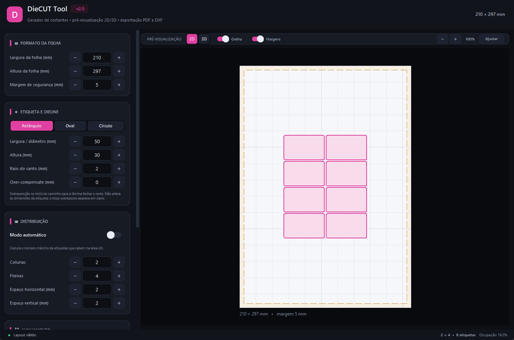
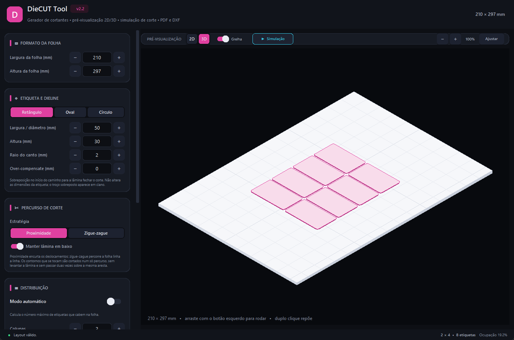
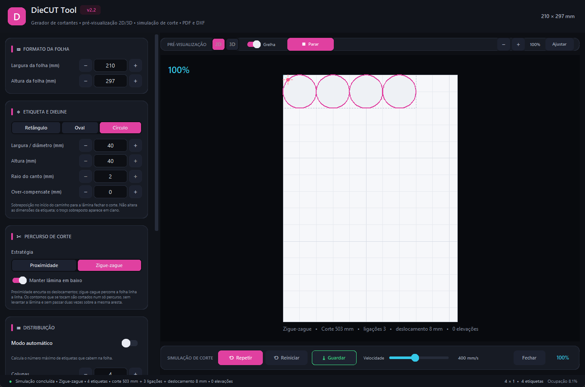
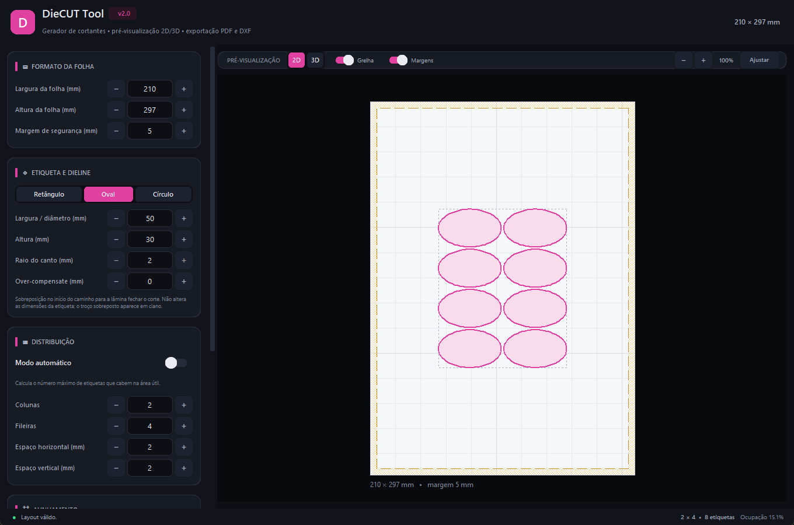
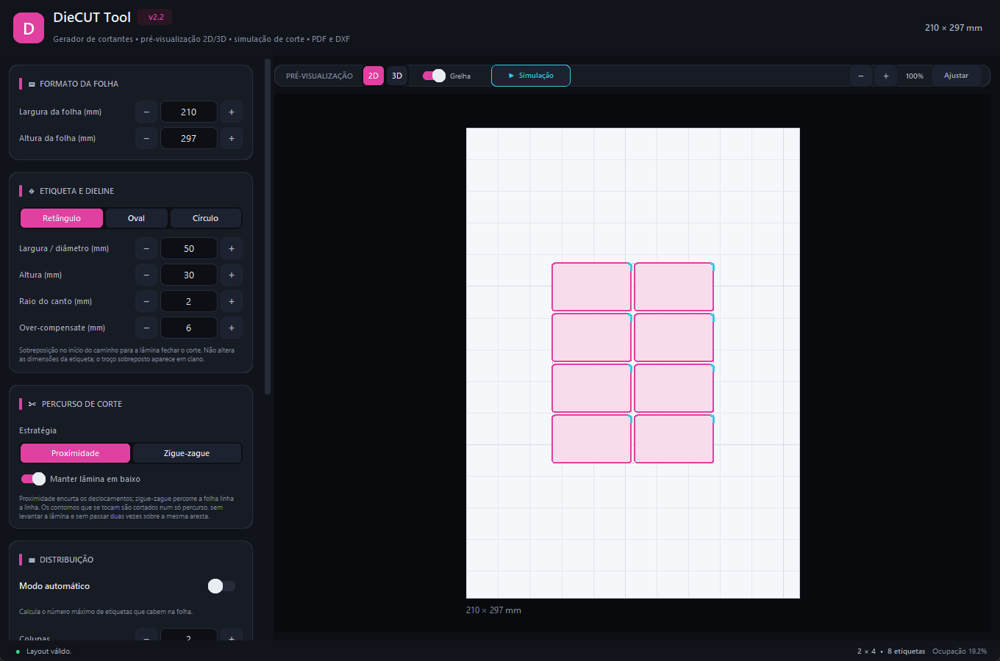
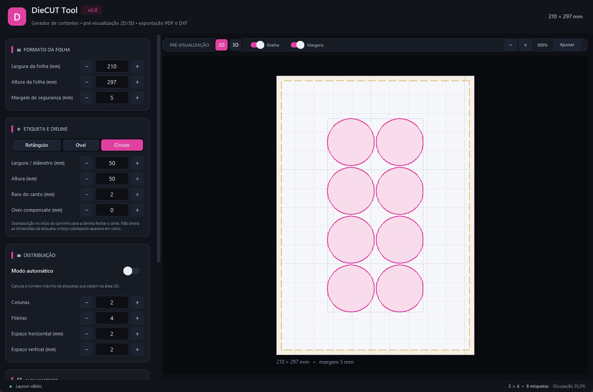
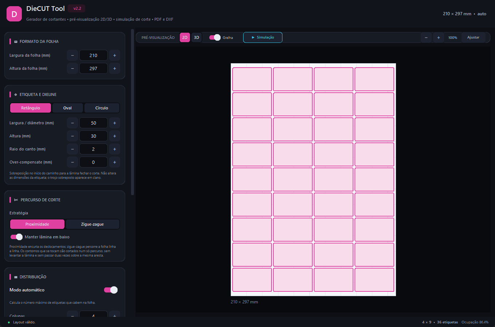

<div align="center">



# DieCUT Tool

**Gerador de cortantes (dielines) para etiquetas em folhas autocolantes.**

Pré-visualização 2D/3D com órbita livre, simulação de corte com percurso otimizado, distribuição automática e exportação vetorial para **PDF** e **DXF**.

[](https://github.com/ruiflow/diecut-tool/releases/latest/download/DieCutTool-v3.exe)
[](https://github.com/ruiflow/diecut-tool/releases/download/v2/DieCutTool-v2.exe)
[-2b2b38?style=for-the-badge&logo=windows&logoColor=white)](https://github.com/ruiflow/diecut-tool/releases/download/v1/DieCutTool-v1.exe)


</div>

---

## O que é

O **DieCUT Tool** calcula e desenha o corte (dieline) de etiquetas numa folha autocolante.
Você informa as medidas da folha e da etiqueta, o programa distribui as etiquetas, mostra o
resultado em pré-visualização e exporta o arquivo pronto para a plotter/cortante.

Nasceu de uma necessidade real de produção: substituir o cálculo manual de colunas e
espaçamentos por um arquivo vetorial que já sai na medida exata da folha.

## Novidades na v3

- **Percurso de corte otimizado**: escolha entre **Proximidade** (vizinho mais
  próximo + 2-opt) e **Zigue-zague** (linha a linha, com serpentina entre
  contornos encostados).
- **Sem cortes repetidos**: os contornos são fundidos num grafo de arestas
  únicas. Cada aresta é cortada uma só vez; o percurso pode passar pelo mesmo
  vértice ou ponto de contacto.
- **Menos elevações de lâmina**: contornos que se tocam são cortados num só
  percurso. Quando um único trilho é impossível, o componente é dividido em
  trilhos válidos e a lâmina levanta apenas entre eles.
- **Guardar o percurso**: durante a simulação, exporte o traçado pela ordem
  calculada em DXF (layers `CORTE` e `DESLOCAMENTO`) ou PDF de referência.
- **Estatísticas da simulação**: comprimento cortado, ligações entre contornos,
  deslocamentos em vazio e número de elevações.

## Demonstração

| Pré-visualização 2D | Vista 3D com órbita |
| :---: | :---: |
|  |  |
| Grelha adaptativa e recorte das dielines que saem da folha | Folha em perspetiva com espessura, relevo e rotação 360° com o rato |

| Simulação de corte |
| :---: |
|  |
| Percurso por proximidade ou zigue-zague, contornos encostados cortados sem repetir arestas e exportação do percurso otimizado |

| Formatos ovais e círculos | Over-compensate e modo automático |
| :---: | :---: |
|  |  |
| Etiquetas ovais, além de retângulo com raio de canto e círculo | Troço de sobreposição de 6 mm em ciano, com zoom em 149% |

| Círculo (medidas acopladas) | Modo automático |
| :---: | :---: |
|  |  |
| No formato círculo, largura e altura são sincronizadas | Colunas e fileiras calculadas a partir da folha inteira: 4 × 9 = 36 etiquetas |

## Funcionalidades

| | |
| --- | --- |
| **Pré-visualização 2D/3D** | Vista 2D com zoom/pan e vista 3D com órbita 360° pelo rato, espessura, relevo e oclusão por profundidade. |
| **Simulação de corte** | Reproduz uma plotter a cortar a folha, com cabeça animada, velocidade ajustável, estatísticas (corte, ligações, deslocamento e elevações) e percurso otimizado por **proximidade** ou **zigue-zague**. |
| **Menos elevações de lâmina** | Os contornos que se tocam são fundidos num grafo de arestas únicas: o corte continua de um para o outro sem levantar a lâmina e sem passar duas vezes sobre a mesma aresta. |
| **Guardar percurso** | Exporta o traçado pela ordem da simulação em DXF (layers `CORTE` e `DESLOCAMENTO`) ou PDF de referência. Cada trilho contínuo fica numa única polilinha, cortada num só movimento. |
| **Modo automático** | Calcula o número máximo de colunas e fileiras que cabem na folha, atualizado em tempo real. |
| **Formatos de etiqueta** | Retângulo (com raio de canto), oval e círculo. |
| **Over-compensate** | Sobreposição no início do caminho para a lâmina fechar o corte, sem alterar a medida da etiqueta. O troço aparece em ciano. |
| **Exportação PDF** | Vetorial, uma página no tamanho exato da folha. |
| **Exportação DXF** | Milímetros, `$INSUNITS = 4`, todas as dielines no layer `DIELINE`. |
| **Validação em tempo real** | Avisa quando o layout excede a folha e bloqueia a exportação de dielines fora da área. |
| **Atalhos** | `Ctrl+P` PDF, `Ctrl+D` DXF, `Ctrl+0` ajustar, `Ctrl+ + / -` zoom, `F5` simulação. |

## Download

Os executáveis ficam na aba [**Releases**](https://github.com/ruiflow/diecut-tool/releases) —
não é preciso instalar Python nem dependências.

| Versão | Arquivo | Tamanho | Observação |
| --- | --- | --- | --- |
| **v3** | `DieCutTool-v3.exe` | ~38 MB | Atual: percurso por proximidade/zigue-zague, sem repetir arestas, guardar corte em DXF/PDF |
| **v2** | `DieCutTool-v2.exe` | ~36 MB | Versão anterior: interface nova, 2D/3D, DXF e modo automático |
| **v1** | `DieCutTool-v1.exe` | ~30 MB | Versão original (legado), mantida para compatibilidade |

> O código-fonte atual está em **`app/`** e corresponde à **v3**. O executável
> publicado já inclui todas as funcionalidades descritas acima.

> O Windows pode exibir o aviso do SmartScreen porque o executável não é assinado
> digitalmente. Clique em **Mais informações → Executar assim mesmo**.

## Executar a partir do código

Requisitos: Python 3.10+ no Windows.

A partir da raiz do repositório:

```powershell
python -m venv .venv
.\.venv\Scripts\python.exe -m pip install -r requirements.txt
.\.venv\Scripts\python.exe main.py
```

### Testes

```powershell
.\.venv\Scripts\python.exe -m unittest discover -s tests -v
```

32 testes cobrem cálculo automático, alinhamento, compensação, geometria,
projeção 3D, as duas estratégias de percurso, a partilha de arestas, os trilhos
em serpentina e a exportação real para PDF/DXF (validada com `ezdxf`).

### Gerar o executável

```powershell
.\.venv\Scripts\python.exe -m pip install pyinstaller
.\.venv\Scripts\pyinstaller.exe --noconfirm --clean DieCutTool.spec
```

O resultado fica em `dist/DieCutTool v3.exe`. Também pode usar
`.\scripts\build.ps1`.

## Estrutura do repositório

```text
.
├── main.py                  # entrada da aplicação
├── app/                     # código da aplicação
│   ├── models.py            # folha, etiqueta, layout e compensação
│   ├── geometry.py          # contornos, áreas e projeção 3D
│   ├── layout.py            # modo automático e posicionamento
│   ├── cutting.py           # estratégias de percurso e plano de corte
│   ├── exporters.py         # PDF/DXF das dielines e do percurso
│   ├── resources.py         # recursos em dev e no executável
│   └── ui/                  # janela, pré-visualização e widgets
├── assets/                  # ícones
├── tests/                   # testes do núcleo
├── tools/                   # gerador do ícone
├── docs/                    # documentação e capturas de ecrã
├── scripts/                 # build e publicação
├── legacy/                  # versão 1 arquivada (não usada pela aplicação)
├── requirements.txt
├── requirements.lock.txt
├── DieCutTool.spec          # build PyInstaller
└── README.md
```

**v1 × v3:** a v1 é um aplicativo único em Tkinter (`FlowCutApp`, `LayoutCalculator`),
mantido em `legacy/` apenas como histórico e para download. Todo o desenvolvimento
acontece na versão atual, modular (`app/models.py`, `geometry.py`, `layout.py`,
`cutting.py`, `exporters.py`, `ui/`) e sem qualquer dependência da v1.

Documentação técnica e instruções de build: [`docs/development.md`](docs/development.md).

## Licença

Sem licença definida até o momento — todos os direitos reservados ao autor.
